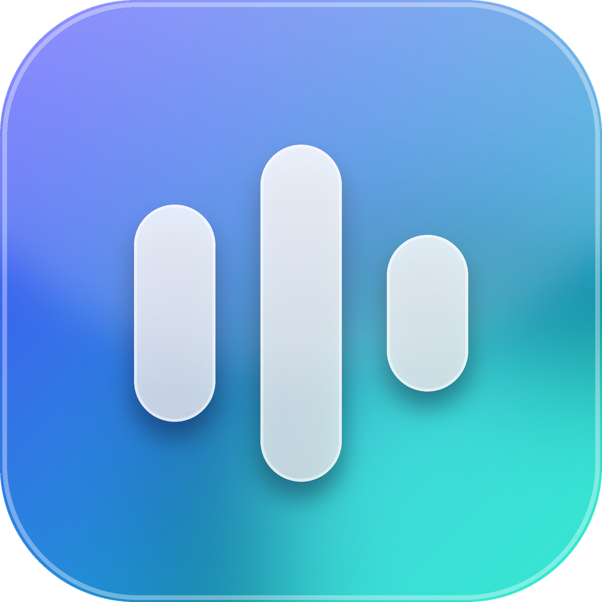
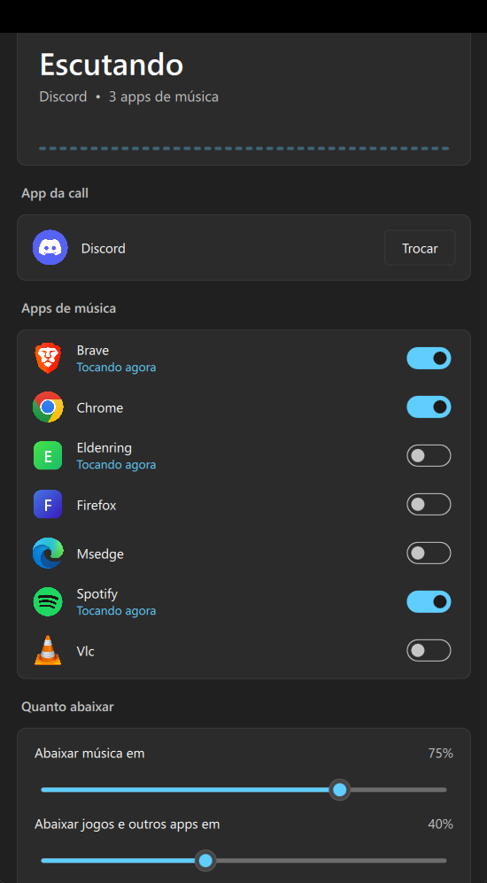

<p align="center">
  
</p>

<h1 align="center">Audio Balancer</h1>


**Automatic volume balance between your game, your music and your voice chat, for Windows.**

You are in a Discord call with friends, playing a game, with music in the background. Everything lands in the same headphones. Audio Balancer listens to the call, and the moment someone starts talking it fades the music and the game down so the conversation comes through. When the call goes quiet, everything fades back to your normal volume.

No more reaching for the Volume Mixer every time someone speaks.

<p align="center">
  
</p>

## Download and install

1. Go to the [latest release](https://github.com/joaormonteiro/audio-balancer/releases/latest) and download **AudioBalancer.exe**.
2. Double-click it. There is no installer: the app opens its window and puts an icon in the system tray (near the clock). The file is about 65 MB because it bundles everything it needs.
3. That's it. Join a call and play something.

> **Windows SmartScreen warning:** the app is not code-signed, so Windows may say "Windows protected your PC" the first time. Click **More info**, then **Run anyway**. The full source code is in this repository, and you can build the exe yourself (see below).

## How to use

- **Call app (tile top left):** the app that carries your friends' voices. Discord is the default. You can pick another one from the list (TeamSpeak, Mumble, Zoom...) or type its process name.
- **Music apps (tile top right):** tick the apps that play your music (Spotify, a browser for YouTube...). Apps currently making sound are marked "Playing now". Everything not ticked, such as your game, is treated as "games and other apps".
- **Lower music / Lower games:** how much each group drops while someone is talking. The defaults are 75% for music and 40% for games.
- **Voice sensitivity:** raise it if quiet voices are not detected, lower it if the volume dips when nobody is talking.
- **Enabled:** pause and resume without closing the app. Pausing returns every volume to normal.
- **Start with Windows / Start minimized:** run it quietly in the background at login.

Closing the window sends the app to the tray and keeps it running. Use **Quit** in the tray menu to exit; your volumes are restored on exit.

Settings are saved automatically in `%APPDATA%\audio-balancer\config.json`.

## How it works

- **Per-app volume control:** uses the Windows Core Audio API (WASAPI) through [pycaw](https://github.com/AndreMiras/pycaw) to change the volume of individual apps, exactly like the Windows Volume Mixer.
- **Speech detection:** reads the output level meter of the call app. The call app only plays other people's voices to your headphones, so a level above the threshold means someone is talking.
- **Works across outputs:** scans every active output device (monitor, speakers, TV, Bluetooth), so the call and the music can play on different devices.
- **Leak compensation:** on some setups the call app's meter mirrors a fraction of what other apps play on the same output, which would make the music look like speech. The app measures that ratio continuously and subtracts it, so music alone never triggers the ducking.
- **Smooth fades:** a fast fade down when speech starts and a slow fade up after about a second of silence, so the volume does not flutter between sentences. Short sounds such as join and leave notifications are ignored.
- **Respects manual changes:** if you change an app's volume yourself, the app learns the new base volume.

## Look and feel and performance

The interface follows the native Windows 11 (Fluent) style, in light or dark to match your system: cards, toggles, the real icon and name of each app, and a live sound-bar meter that shows the call's level.

It is built to stay out of your game's way:

- **Tray only:** about 60 MB of RAM and roughly 0.1% of one CPU core. No UI code is running at all.
- **Window open:** the window is a separate process that exists only while it is open, so closing it gives all of its memory back (it uses around 200 MB while open).
- **Engine:** runs at below-normal priority, polls every 250 ms when nothing is happening and only goes to 50 ms while someone is actually speaking. Windows audio objects are cached, so steady state makes no audio API calls.

## Limitations

- Windows only (needs WASAPI).
- Browsers expose one audio session for all tabs, so a YouTube tab is lowered together with every other tab that is playing sound.
- Games with exclusive-mode audio can bypass the Windows mixer, in which case their volume cannot be lowered.

## Run from source

Requires Windows and Python 3.10+.

```bash
python -m venv .venv
.venv\Scripts\pip install -r requirements.txt

# window + tray
.venv\Scripts\python -m audio_balancer

# console only, with live levels (useful for debugging)
.venv\Scripts\python -m audio_balancer --debug

# list the apps currently producing sound
.venv\Scripts\python -m audio_balancer --list
```

## Build the exe yourself

```bash
.venv\Scripts\python build.py
```

The result is `dist\AudioBalancer.exe` (one file, no console window). The icon and window backdrop are generated by `python tools/make_assets.py`; you only need to run it when you change the design.
